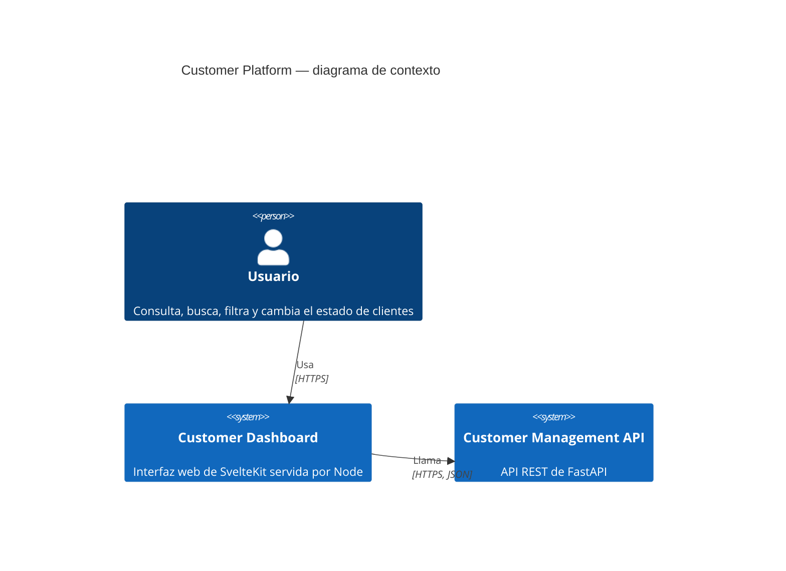
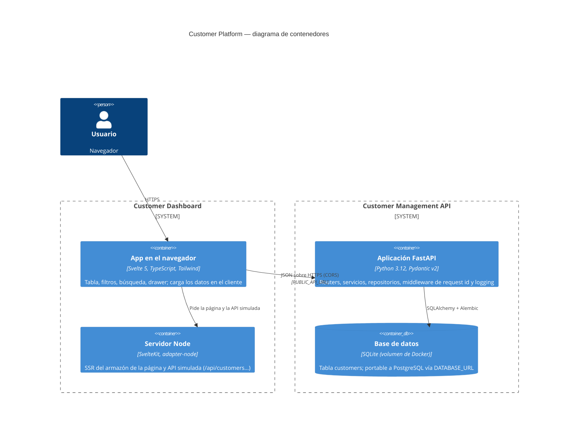
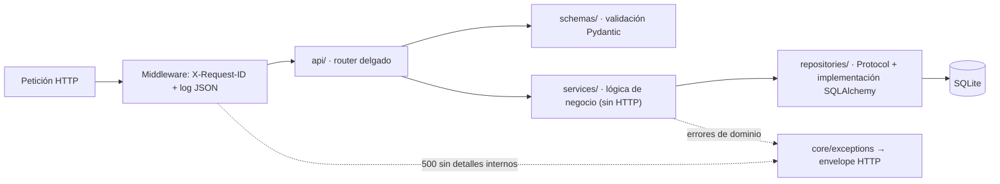

# Arquitectura (C4)

Los diagramas siguen el [modelo C4](https://c4model.com): primero el sistema en su contexto,
luego sus contenedores. Están escritos en Mermaid, que GitHub renderiza sin herramientas
adicionales.

## Nivel 1: contexto del sistema

Una sola persona usa el dashboard, que se apoya en la API para leer y escribir clientes. La API
no depende de ningún sistema externo: su base de datos es un SQLite local (un volumen de Docker
en despliegue), pensado para ser sustituido por PostgreSQL cambiando `DATABASE_URL`.



Dos detalles que el diagrama no muestra y que conviene saber:

- El dashboard funciona **sin** la API: sin `PUBLIC_API_URL` sirve una API simulada dentro de su
  propio servidor.
- El navegador llama a la API **directamente**, no a través del frontend. Por eso
  `PUBLIC_API_URL` es una URL del host (`http://localhost:8000`) y nunca el nombre interno del
  servicio de Docker (`http://backend:8000`).

## Nivel 2: contenedores



### Cómo se organiza el backend por dentro



- `api/` solo habla HTTP; `services.py` no importa FastAPI y decide con excepciones de dominio;
  `repositories.py` define la interfaz (`Protocol`) y su implementación, inyectada por
  dependencia.
- Toda respuesta de error comparte un formato con `code`, `message` y `request_id`, incluidos los
  `422` de Pydantic y los `500`.

### Despliegue (Docker Compose)

```
docker compose up --build
├── backend  (python:3.12-slim, uid 10001)
│   ├── entrypoint.sh → alembic upgrade head → seed (salvo SEED_ON_STARTUP=false)
│   └── uvicorn :8000  ── volumen backend_data → /data/customers.db
└── frontend (node:22-slim, uid 1000)
    └── node build :3000  ── PUBLIC_API_URL la lee el navegador
```

Ambos contenedores tienen healthcheck (el del backend, contra `/health`) y corren con usuario
propio, sin privilegios nuevos (`no-new-privileges`).
