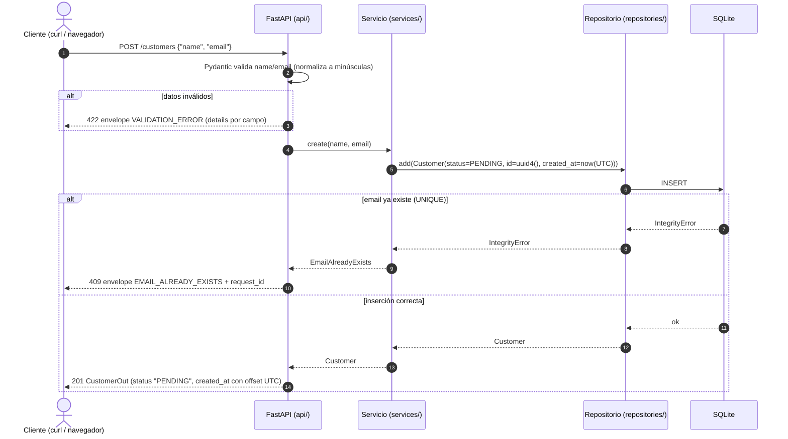
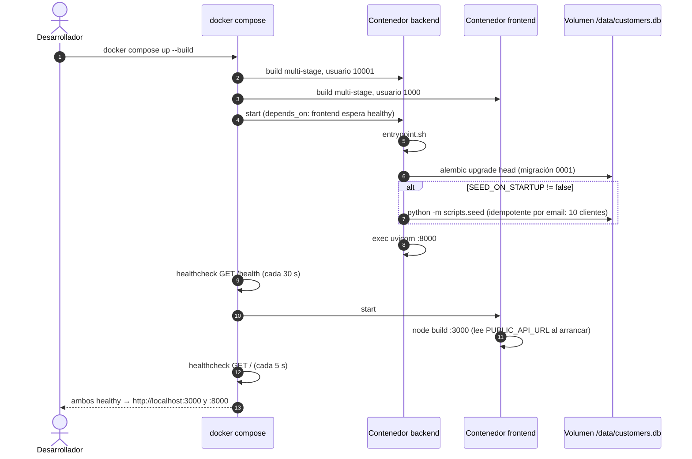

# Diagramas de secuencia

Tres flujos representativos. Los tres están escritos en Mermaid. Los códigos y cuerpos de error
son literales: salieron de ejecutar la API (ver el [README](../../README.md) para reproducirlos).

## 1. Crear un cliente — `POST /customers`

El caso feliz y el duplicado, que no se resuelve con una consulta previa sino con la restricción
`UNIQUE` de la base de datos.



Notas: el `409` se produce aunque el duplicado llegue con otras mayúsculas, porque el email se
normaliza antes de guardarlo. El `request_id` del cuerpo es el mismo del encabezado
`X-Request-ID` de la respuesta y de la línea de log de la petición.

## 2. Cambiar el estado desde el dashboard — `PATCH /customers/{id}/status`

Flujo completo con el drawer abierto. La actualización **no es optimista**: la interfaz cambia
con la respuesta del servidor.

```mermaid
sequenceDiagram
    autonumber
    actor U as Usuario
    participant B as Navegador (drawer)
    participant F as Store (runes)
    participant API as FastAPI
    participant DB as SQLite

    U->>B: pulsa "Bloqueado" en Cambiar estado
    B->>B: deshabilita opciones, aria-busy, "Guardando…"
    B->>F: updateStatus(id, BLOCKED)
    F->>API: PATCH /customers/{id}/status {"status":"BLOCKED"}
    API->>API: valida status contra el enum
    alt estado inválido
        API-->>F: 422 envelope VALIDATION_ERROR
    else id no existe
        API-->>F: 404 envelope CUSTOMER_NOT_FOUND
    else ok
        API->>DB: UPDATE customers SET status
        DB-->>API: ok
        API-->>F: 200 Customer actualizado
        F->>F: reemplaza la fila con la respuesta (lista y contadores reaccionan)
        F-->>B: Customer
        B->>B: badge nuevo, aria-live "Estado actualizado a Bloqueado."
    end
    note over B,F: Si falla: role="alert" con el error en español (por code); la lista no se toca.
    U->>B: Esc / clic fuera / cerrar
    B-->>U: el foco vuelve al botón "Ver detalle" que abrió el drawer
```

## 3. Arranque del stack — `docker compose up --build`

Lo que ocurre desde el comando hasta tener los dos servicios sanos.



Nota: con un volumen nuevo y `SEED_ON_STARTUP=false` la base queda vacía (`GET /customers`
devuelve `[]`), lo que sirve para demostrar el estado "No hay clientes registrados" del dashboard.
