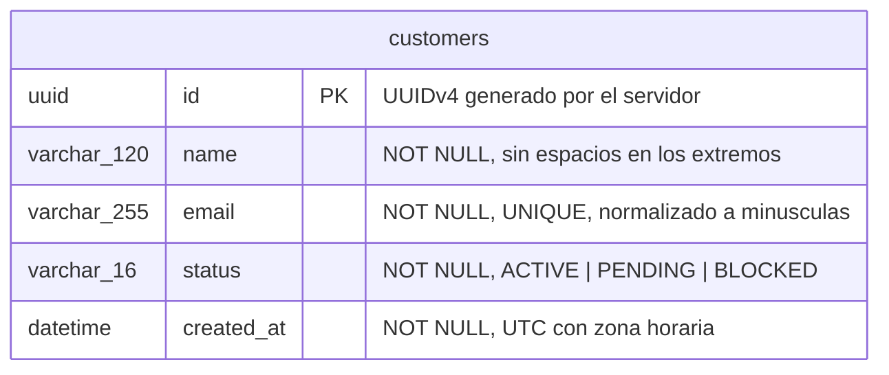

# Modelo de datos

Una sola tabla, `customers`, creada por la migración
[`0001_create_customers_table`](../../backend/alembic/versions/0001_create_customers_table.py).

## Diagrama entidad-relación

## Columnas

| Columna | Tipo SQL | Reglas | Quién lo genera |
| --- | --- | --- | --- |
| `id` | `Uuid` (CHAR(32) en SQLite) | PK | El servidor, `uuid.uuid4()`, al insertar |
| `name` | `String(120)` | 1–120 caracteres, recortado (strip) | El cliente lo envía |
| `email` | `String(255)` | `UNIQUE`, formato validado por `EmailStr`, normalizado (strip + minúsculas) | El cliente lo envía |
| `status` | `String(16)` | `ACTIVE`, `PENDING` o `BLOCKED`; siempre nace `PENDING` | La API (nunca el body de creación) |
| `created_at` | `DateTime(timezone=True)` | UTC con offset (`...Z`) | El servidor, `datetime.now(UTC)` |

Definición en el ORM: [`backend/app/models.py`](../../backend/app/models.py).

## Decisiones

- **`id` UUIDv4 como PK.** Sin coordenación entre instancias para generarlo y no expone un
  contador de clientes en la URL. El costo es el índice menos eficiente que un entero; con una
  tabla de clientes es irrelevante.
- **El email es único en la base de datos**, no solo en el código: el `409` sale de capturar la
  `IntegrityError` que levanta la restricción `UNIQUE` al insertar. Una consulta previa
  "existe?" tendría una condición de carrera entre dos peticiones simultáneas. El email se
  normaliza a minúsculas antes de guardarlo, así que `Juan@LiquidMX.com` y `juan@liquidmx.com`
  chocan con el mismo `409`.
- **`status` es texto, no un enum de base de datos.** Los valores permitidos se definen una vez
  (`CustomerStatus` en `schemas.py`) y la API los valida en el borde: es la única escritora de la
  tabla. En SQLite un `CHECK` añadiría ruido sin añadir garantía real; si la tabla pasara a ser
  escrita por otros servicios, un `CHECK` o un enum nativo en PostgreSQL serían razonables.
- **`created_at` con zona horaria siempre UTC.** Se genera con `datetime.now(UTC)` y se
  normaliza en un único punto al serializar (`CustomerOut`), de modo que la respuesta termina en
  `Z`/`+00:00` aunque SQLite devuelva datetimes ingenuos. El dashboard la formatea en UTC fijo
  para que la lista no cambie según la zona del navegador.
- **Sin `updated_at` ni borrado lógico.** El dominio del reto no los pide; añadirlos sería
  especular (YAGNI).

## Portabilidad a PostgreSQL

`DATABASE_URL` decide el motor sin tocar código. Lo que ya es portable: tipos estándar
(`Uuid`, `String`, `DateTime`), el `uuid.uuid4()` generado en la aplicación (no depende de
funciones del motor) y Alembic con `render_as_batch=True` para que las migraciones futuras
funcionen también en SQLite. Lo que cambiaría: SQLite guarda `Uuid` como CHAR(32) y PostgreSQL
tiene `UUID` nativo — una migración de datos debería convertir la columna. **PostgreSQL no se ha
ejecutado** en este proyecto (ver "Qué se verificó y qué no" del [README](../../README.md)).
